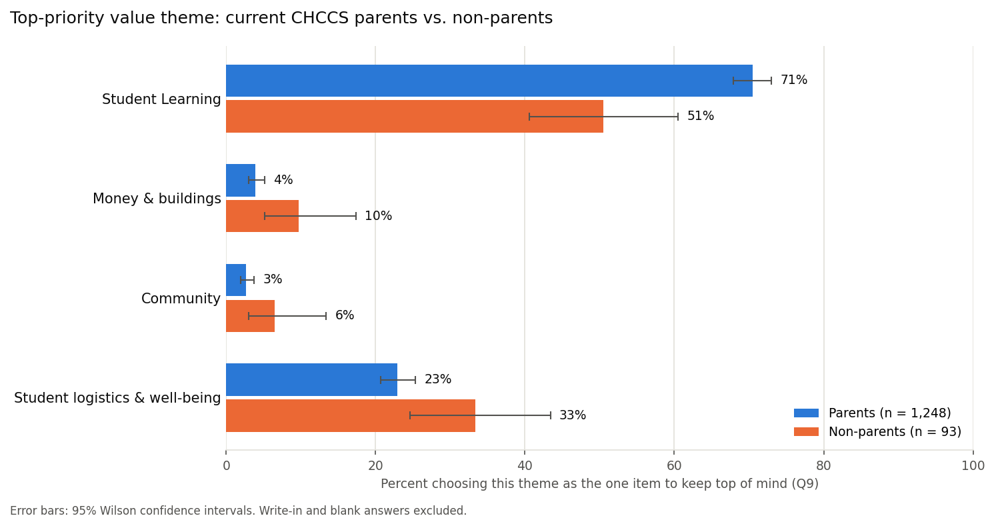

# Comparing the Top Priorities of CHCCS Parents and Non-Parents

AIPI 510 Module 2 project (statistical analysis) · Jim Redden · November 2026

Do parents of current Chapel Hill-Carrboro City Schools (CHCCS) students and non-parents choose different values as their top priority for the district's elementary redistricting? This project tests that question with the district's public **Community Priorities Assessment** (1,463 responses, fall 2026). It builds on my Module 1 project on CHCCS enrollment decline.

## Key result

Using a pre-registered analysis, parents (n = 1,248) and non-parents (n = 93, mostly CHCCS staff) differed significantly in which value theme they chose as their single top priority. The difference was small and concentrated in Student Learning, chosen by 71% of parents vs. 51% of non-parents.

| | |
|---|---|
| Test | Monte Carlo exact test, 100,000 permutations (pre-specified fallback for small expected counts) |
| Result | χ² = 19.90, df = 3, p = 0.0006 |
| Effect size | Cramér's V = 0.12, 95% bootstrap CI 0.07–0.20 |

The respondent pool is about 13 parents for every non-parent, and the design is observational, so the difference can't be attributed causally to parent status. See [`docs/report.md`](docs/report.md) for the full write-up and [`LIMITATIONS.md`](LIMITATIONS.md) for all limitations.



## Repository structure

```
├── README.md
├── LIMITATIONS.md              running limitations tracker
├── ai-collaboration.md         how AI was used in this project
├── requirements.txt
├── docs/
│   ├── analysis_plan.md        pre-registered plan (committed before any outcome data was read)
│   └── report.md               written report
├── data/
│   ├── README.md               data catalog
│   ├── raw/                    CHCCS survey workbook, unmodified
│   ├── processed/              analysis-ready tables (generated)
│   └── final/                  results tables (generated)
├── figures/                    generated figures
├── exploratory_analysis/       post-project exploration, outside the pre-registered scope (see its README)
└── src/
    ├── one_hot_encode_q1.py         Q1 respondent roles -> one-hot table
    ├── explore_respondent_groups.py group sizes, power, Figure 2
    ├── prepare_q9.py                Q9 answers -> values, themes, groups
    ├── run_chi_square.py            the pre-registered test, effect size, post hoc, Figure 1
    └── make_result_figures.py       pooled-vs-groups and residual-heatmap figures of the result
```

## Data

**Source:** Chapel Hill-Carrboro City Schools, *Community Priorities Assessment* raw response workbook (eight language tabs), published with the district's *Priorities & Values Conversations, Fall 2026* report on the CHCCS Together document library: https://www.chccstogether.org/document-library

The survey ran September 28 to October 9, 2026. The results are public, so the raw workbook and all derived data are committed. See [`data/README.md`](data/README.md) for what each file contains and which script produces it.

## Reproducing the analysis

### Prerequisites
- Python 3.10+
- Git

### Installation
```bash
git clone https://github.com/jr613d/AIPI_510_Module2_Project.git
cd AIPI_510_Module2_Project
python3 -m venv .venv
source .venv/bin/activate
pip install -r requirements.txt
```

### Run the pipeline
Run from the repository root, in this order:

```bash
python src/one_hot_encode_q1.py          # data/processed/chccs_respondent_relationships.csv
python src/explore_respondent_groups.py  # group sizes, minimum detectable effects, figures/respondents_by_role.png
python src/prepare_q9.py                 # data/processed/q9_value_themes.csv
python src/run_chi_square.py             # data/final/q9_*.csv, figures/q9_theme_by_group.png
python src/make_result_figures.py        # figures/q9_pooled_vs_groups.png, figures/q9_residuals_heatmap.png
```

The whole pipeline runs in under a minute. Random steps (permutations and bootstrap) use a fixed seed, so results reproduce exactly.

## Method in brief

- **Groups:** current CHCCS parents vs. respondents with no parent role, from the select-all-that-apply relationship question (50 respondents in other parental roles excluded).
- **Outcome:** the single value respondents most want kept "top of mind" (Q9), grouped into four themes fixed before the data was examined: Student Learning; Money & buildings; Community; Student logistics & well-being.
- **Test:** chi-square test of independence, with a pre-specified Monte Carlo exact test when any expected count is below 5 (which occurred).
- **Effect size and post hoc:** Cramér's V with a bootstrap CI; adjusted standardized residuals with a Bonferroni correction.
- **Pre-registration:** the plan in [`docs/analysis_plan.md`](docs/analysis_plan.md) was committed before any script read the outcome data; the commit history shows the order.

## Exploratory analysis

Work done after the pre-registered test, outside the project's scope, lives in [`exploratory_analysis/`](exploratory_analysis/). It includes a Board vs. survey comparison, all 13 values by group and the 1–5 value ratings. None of it is confirmatory; its README explains why it's kept separate.

## AI use

This project was done with an AI assistant (Claude) as an execution partner. See [`ai-collaboration.md`](ai-collaboration.md).

## License

MIT. See [`LICENSE`](LICENSE).
