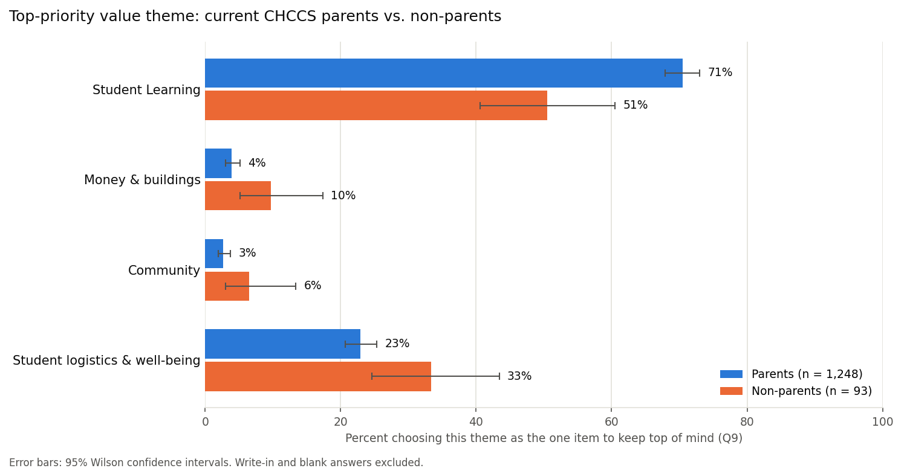
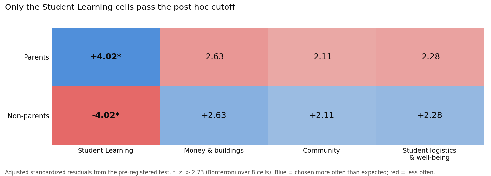
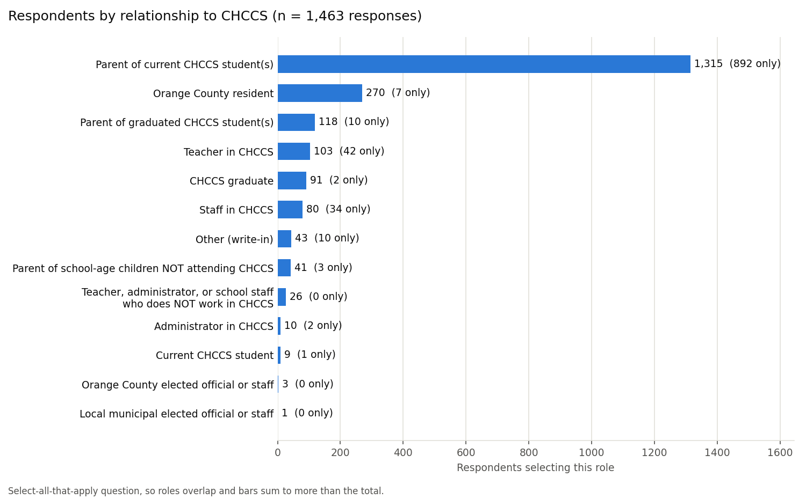
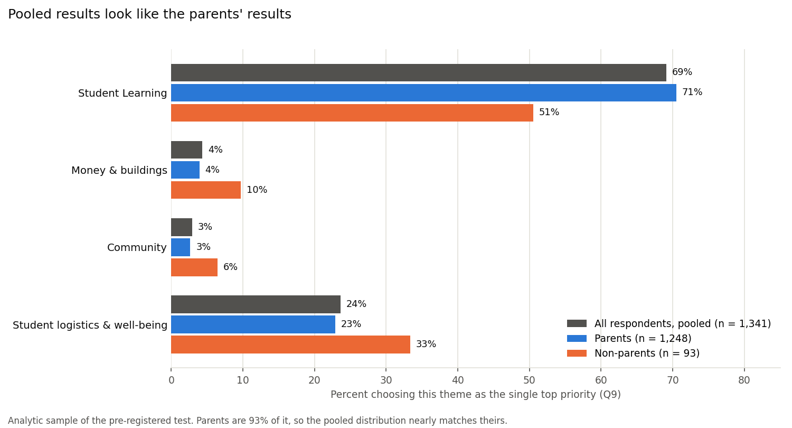

# Comparing the Top Priorities of CHCCS Parents and Non-Parents in a Community Survey

**Jim Redden** · AIPI 510: Data Sourcing and Analytics · Module 2 Project: Statistical Analysis · November 2026

Code and data: https://github.com/jr613d/AIPI_510_Module2_Project

---

## Abstract

In 2026, Chapel Hill-Carrboro City Schools (CHCCS) began planning school closures and redistricting after several years of falling elementary enrollment. As part of that planning, the district ran a public Community Priorities Assessment and published the results. This project asks whether two groups who answered that survey, parents of current CHCCS students and people with no parent role, chose different values as their single top priority for the planning process. Respondents were assigned to mutually exclusive groups from the survey's select-all-that-apply relationship question, and the 13 values were consolidated into four themes (Student Learning; Money & buildings; Community; and Student logistics & well-being) to keep cell counts adequate given the small non-parent group. The hypotheses, group definitions, theme mapping and test were pre-registered in an analysis plan committed to GitHub before the outcome data were examined. Because the outcome is categorical, the planned test was a chi-square test of independence on the resulting 2 × 4 table; two cells fell below the minimum expected count of 5, so the pre-specified alternative, a Monte Carlo exact test with 100,000 permutations, was used. Parents (n = 1,248) and non-parents (n = 93) differed significantly (χ² = 19.90, df = 3, p = 0.0006), but the effect was small (Cramér's V = 0.12, 95% CI 0.07–0.20). The difference came mainly from one theme: 70.5% of parents chose Student Learning as their top priority, compared with 50.5% of non-parents. Three limitations qualify these findings. First, the data come from a survey instrument the district designed for its own purposes; unclear terms and the absence of questions about the redistricting trade-offs themselves limit what the responses can measure. Second, the sample is self-selected and heavily imbalanced, with roughly 13 parents for every non-parent, consistent with parents having the most direct stake in redistricting; the imbalance limits the precision of the non-parent estimates and means the district's pooled results largely reflect parents' views. Third, the design is observational: group membership was self-reported rather than assigned, and most non-parents are district employees, so the difference cannot be attributed causally to parent status.

---

## 1. Background and Motivation

### 1.1 Connection to Module 1

This project builds directly on my Module 1 project, *An analysis of enrollment decline in Chapel Hill-Carrboro City Schools*. I live in the district and my children are about to start elementary school there, so the district's 2026 decision to close elementary schools and redistrict affects my family directly.

My Module 1 project found that:

- CHCCS elementary enrollment fell **16.5%** from 2019 to 2024, more than twice the decline of the median North Carolina district.
- About **two-thirds** of the district's overall enrollment decline reflects fewer school-age children living in the district.
- About **one-third** (roughly 355 students) reflects children who live in the district but enroll elsewhere: charter schools, private schools or homeschooling.

The district's case for closures is financial: state funding follows enrollment, while facility and staffing costs are largely fixed. Module 1 concluded that enrollment data can establish that the district faces a real problem but cannot determine how it should respond. That is a question of values and of whose priorities are weighed, which this project takes up.

### 1.2 The survey

To inform its elementary redistricting process, CHCCS conducted a **Community Priorities Assessment (CPA)**. The survey was open for two weeks, from September 28 to October 9, 2026, was distributed digitally, and was available in eight languages. Respondents rated 13 challenges and 13 values, selected their top three of each, and named the **single value** they most wanted kept "top of mind." The survey opened with a select-all-that-apply question on the respondent's relationship to the district (parent, teacher, resident and so on).

The CPA was one input to a broader engagement effort the district summarized in its *Priorities & Values Conversations, Fall 2026* report (the "Full Report"). That effort also included a parallel Board Priorities Assessment completed by all seven Board of Education members, a Redistricting Advisory Committee session, two in-person community meetings (October 7 and 8), three virtual sessions (October 13–15), and public comments. Results were presented to the Board on October 15 and at its October 21 retreat, and the Full Report and raw response workbook were published on the district's CHCCS Together site. The redistricting timeline continues with draft boundary scenarios in November 2026 and a Board vote on final boundaries scheduled for January 21, 2027, so the priorities captured here are meant to shape decisions that are still pending. Apart from the group counts described in Section 3.4, none of the survey results or reports were reviewed before the hypotheses and analysis plan were written.

### 1.3 Selecting the question

An earlier direction was set aside. An analysis of whether families leave lower-rated schools, using North Carolina School Report Card data, was substantive, but outcome summaries were examined before hypotheses were written, which compromised its confirmatory value (see Section 3.4). The CHCCS survey offered a question of direct interest, a clear link to Module 1, a large sample, and outcome data that had not yet been examined, allowing a plan to be written first.

---

## 2. Research Question and Hypotheses

**Research question:** Do current CHCCS parents and non-parents differ in which value they most want kept top of mind in the district's planning?

The outcome is each respondent's answer to the survey's final question (Q9), mapped to one of four value themes (Section 3.3). Consistent with the hypothesis-testing procedure in the course text (Statistics, Chapter 3), the hypotheses were specified before the outcome data were examined:

- **H₀:** Value theme is independent of group; parents and non-parents choose each theme in the same proportions.
- **H₁:** The distribution of value themes differs between parents and non-parents.

The alternative is two-sided, with no predicted direction. I designated **a single confirmatory test**. With 26 rated items and several possible groupings, testing broadly would invite the multiple comparisons problem described in Chapter 3; limiting the confirmatory analysis to one test allows α = 0.05 without correction. All other comparisons are designated exploratory.

---

## 3. Study Design

### 3.1 Observational design

CHCCS designed and administered the survey, respondents self-selected, and group membership is self-reported, so this is an observational comparison rather than an experiment. The instructor confirmed that this design meets the project requirements. The study can establish whether the groups' responses differ, but not that parent status causes the difference; characteristics associated with being a parent (age, income, neighborhood, a child's particular school) are potential confounders.

### 3.2 Variables and groups

| Element | In this study |
|---|---|
| Independent variable | Respondent group (parent or non-parent), derived from the relationship question (Q1) |
| Dependent variable | Value theme of the item chosen in Q9 |
| Comparison condition | Non-parents |
| Randomization | Not applicable (observational data) |

Because Q1 allowed multiple selections, a single respondent could be a parent, a teacher and a resident. Mutually exclusive groups were defined before any outcome data were examined:

| Group | Rule | Responses |
|---|---|---|
| **Parents** | Selected "Parent of current CHCCS student(s)" | 1,315 |
| **Non-parents** | Selected no parent option and did not write in a parent, future-parent, grandparent or guardian role | 98 |
| Excluded | Other parental roles: parents of graduates, parents whose children all attend non-CHCCS schools, expecting parents, grandparents raising children | 50 |

The excluded respondents are neither current CHCCS parents nor non-parents, and assigning them to either group would blur the contrast. Parents who also work for CHCCS (84) remain in the parent group.

Of the 98 non-parents, **87 are CHCCS teachers, staff or administrators**. The comparison is therefore effectively parents versus district staff, and the results are interpreted that way.

### 3.3 Value themes

Splitting 13 values across a non-parent group of 98 would leave most cells nearly empty, so the values were consolidated into four themes before any Q9 responses were examined:

| Theme | Values included |
|---|---|
| **Student Learning** | Educational excellence; Student-centered focus |
| **Money & buildings** | Fiscal responsibility; Maximizing the use of currently available buildings; Long-term planning; Increasing the use of renewable energy |
| **Community** | Community engagement & trust building; Collaboration between schools and county leadership; Community partnerships |
| **Student logistics & well-being** | Minimizing the distance students travel; School safety; High quality school meal service; Well-balanced student populations across schools |

The grouping is a judgment call; renewable energy, for example, is placed with Money & buildings as a facilities investment. Fixing the mapping before seeing the data prevents the boundaries from being drawn, consciously or not, in whatever way yields a significant result.

### 3.4 Pre-registration

The course text recommends fixing α and the test before examining data and writing the plan down (Chapter 3). The research question, group rules, theme mapping, hypotheses, test, effect size, post hoc procedure and a fallback test were recorded in `docs/analysis_plan.md` and committed to GitHub before any code read the Q9 responses. The commit history documents the sequence: the plan was committed at 15:23 on November 1, 2026, and the first script reading Q9 at 15:45 the same day.

Group sizes were examined before the plan was finalized, using only the relationship question. Group counts carry no information about the outcome and were required for the power analysis.

### 3.5 Group imbalance

The two groups are highly unequal: of the 1,341 responses in the test, 1,248 (93.1%) are parents and 93 are non-parents, a ratio of about 13 to 1. Across all 1,463 responses, 90% came from current parents.

The imbalance has a plausible explanation. Parents are the stakeholders most directly affected by closures and redistricting, since their children are the ones who would change schools, and they are therefore the most motivated to follow the planning process and respond. The survey's circumstances reinforced this. It was distributed digitally during a two-week window that coincided with the district's redistricting community meetings, and notes from those meetings in the Full Report suggest promotion ran largely through schools (one attendee recommended posting the survey flyer "in every elementary school in the district for more visibility"). Residents without children have a weaker and less immediate stake and fewer touchpoints with school communications, and staff appear in the data mostly through their employment.

The imbalance does not bias the test itself. The chi-square statistic and the permutation test both condition on the group sizes, and each group's percentages are estimated from that group alone. Its effects are on precision and on interpretation:

- **Precision is asymmetric.** The 95% confidence interval for a non-parent percentage is about 20 percentage points wide (e.g., Student Learning: 40.6–60.5%), compared with about 5 points for parents (67.9–73.0%).
- **Power is set mostly by the smaller group.** In a two-group comparison, an unbalanced design carries roughly the information of a balanced design whose group size is the harmonic mean of the two: here, about 173 per group, or 346 in total, rather than 1,341. With balanced groups of the same total size, a drop from 70.5% to about 63% in one theme's share would be detectable; with these groups, the drop must reach about 56%.
- **Small expected cells.** The imbalance, combined with two rare themes, produced non-parent expected counts below 5, which triggered the exact test (Section 6.2).
- **Pooled results track parents.** Pooling both groups, 69.1% chose Student Learning, almost identical to the parent figure (70.5%). The non-parent figure (50.5%) is effectively invisible in a pooled summary (Figure 4).

Rebalancing techniques do not apply here. The class-balancing methods in the course text (Statistics, Chapter 6), such as undersampling or SMOTE, address imbalance when training classifiers. For inference, undersampling parents would discard information and synthetic responses would fabricate data. Weighting the pooled results to a target population would require population benchmarks for each stakeholder group, which are not available. The appropriate responses are to estimate each group separately, report precision honestly, and treat the imbalance as a finding about who participated.

---

## 4. Power Analysis

### 4.1 Approach

Of the four quantities in a power analysis (effect size, sample size, α and power; Chapter 4), sample size is usually the unknown. Here the survey had already closed, so the sample was fixed and the analysis was run as a **sensitivity analysis**: given n, α = 0.05 and 80% power, it solves for the smallest effect the test could reliably detect.

### 4.2 Calculation

- **Software:** Python, `statsmodels` (`GofChisquarePower`; Seabold & Perktold, 2010)
- **Inputs:** n = 1,341, four themes (3 degrees of freedom), α = 0.05, power = 0.80
- **Result:** minimum detectable effect of **Cramér's V = 0.09** (Cohen's w; Section 6.3)

By conventional benchmarks (0.1 small), the test can detect a small effect overall. As Section 3.5 shows, however, the 13-to-1 imbalance means that in practical terms the detectable difference is roughly 10 to 15 percentage points in a theme's share. Smaller differences may exist and go undetected. The calculation was first run during planning on group sizes and is reported here with final counts, after the planned exclusion of blank and write-in Q9 answers.

---

## 5. Data Collection and Cleaning

### 5.1 Source

The data is the CHCCS Community Priorities Assessment raw response workbook, published with the Full Report among the October 21, 2026 Board retreat materials on the district's CHCCS Together document library (https://www.chccstogether.org/document-library). Because the results are public, the raw workbook is included in the repository. It contains one tab per language; in most non-English tabs, each response row is paired with an adjacent English translation row.

The district describes the 1,463 records as "unique respondents," but the published workbook contains no respondent identifiers, so uniqueness cannot be verified independently (Limitation 5). My processed data reconciles closely with the Full Report. My count of current parents (1,315) differs slightly from the report's 1,319, most likely because of differences in coding translated and write-in responses; for example, I used the original-language answer where a translation disagreed with it. The share choosing "Educational excellence" as the single top value matches the report's 50%.

### 5.2 Data organization

Following the data storytelling text's recommended structure (raw, interim, processed and final stages, plus a data catalog), the repository separates the unmodified workbook (`data/raw/`), analysis-ready tables (`data/processed/`) and reported results (`data/final/`), documented in `data/README.md`. All cleaning and analysis is scripted in `src/`, so every reported number can be regenerated from the raw workbook (Section 13).

### 5.3 Processing steps

1. **Relationship question (Q1).** `one_hot_encode_q1.py` one-hot encodes the select-all-that-apply responses into 13 binary role indicators. Because one answer option itself contains commas, the script matches complete option labels rather than splitting on delimiters. For non-English responses it uses the original-language answer, which identified one case where the supplied English translation was incorrect.
2. **Groups.** `explore_respondent_groups.py` applies the group rules in Section 3.2, using keyword rules to classify write-in roles (e.g., expecting parents, grandparents raising grandchildren).
3. **Q9 and themes.** `prepare_q9.py` extracts each Q9 response (using the English translation for non-English tabs), normalizes spelling variants in the source ("School saftey," "Minimize the distance student travel"), maps responses to the 13 values and four themes, and joins them to group assignments. The script fails if any Q9 record does not align with its Q1 record.

### 5.4 Analytic sample

| Step | Responses |
|---|---|
| All response records | 1,463 |
| Excluded: neither current parent nor non-parent | −50 |
| Excluded: Q9 left blank | −28 |
| Excluded: Q9 write-in rather than a listed value | −44 |
| **Analytic sample** | **1,341** (1,248 parents, 93 non-parents) |

The blank and write-in exclusions were specified in the plan. The write-ins are substantively interesting (several concern walk zones, teacher retention or keeping students at their current schools) but do not map to a single theme.

---

## 6. Statistical Analysis

### 6.1 Test selection

The outcome is categorical, which rules out the t-test and ANOVA families. For the association between two categorical variables, group and theme, the course text's decision tree (Chapter 8) indicates the **chi-square test of independence**, here on a 2 × 4 table with 3 degrees of freedom.

### 6.2 Assumption check and exact test

The chi-square approximation requires expected counts of at least 5 in every cell (Chapter 8). Anticipating that the small non-parent group and rare themes could violate this, the plan specified an exact alternative in advance: the Fisher–Freeman–Halton test (Freeman & Halton, 1951), the generalization of Fisher's exact test beyond 2 × 2 tables, or a Monte Carlo exact test. The condition failed in two cells:

| Expected counts | Student Learning | Money & buildings | Community | Logistics & well-being |
|---|---|---|---|---|
| Parents | 862.7 | 54.0 | 36.3 | 295.0 |
| Non-parents | 64.3 | **4.0** | **2.7** | 22.0 |

The reported p-value therefore comes from a Monte Carlo permutation test. Group labels were randomly permuted across the 1,341 respondents 100,000 times, holding group sizes and theme totals fixed as under the null hypothesis, and the chi-square statistic was recomputed for each permutation. The p-value is the proportion of permuted statistics at least as large as the observed one. This estimates the exact conditional p-value without relying on the large-sample approximation that the small cells undermine.

### 6.3 Effect size: Cramér's V

Because statistical significance does not establish practical significance (Chapter 4), I report an effect size alongside the p-value. The course text's effect size, Cohen's d, applies to differences in means and has no counterpart for a categorical outcome. The chi-square statistic itself is unsuitable because it scales with sample size. I therefore used **Cramér's V** (Cramér, 1946), which normalizes chi-square by sample size and table dimensions:

```
V = sqrt( chi-square / (n × (k − 1)) ),   k = min(rows, columns)
```

For a two-row table, k − 1 = 1 and V equals Cohen's w, the effect size used in the power analysis. V ranges from 0 (identical distributions) to 1 (group fully determines theme), with conventional benchmarks of 0.1, 0.3 and 0.5 for small, medium and large effects (Cohen, 1988).

### 6.4 Confidence intervals

- **Cramér's V:** a 95% percentile bootstrap interval from 10,000 resamples drawn with replacement within each group (Efron & Tibshirani, 1993), extending the bootstrap introduced in Chapter 5 to an effect size with no closed-form interval.
- **Group percentages:** Wilson score intervals (Wilson, 1927), which perform better than the normal-approximation interval when proportions are near 0 or 1 or groups are small, as they are for the non-parents.
- **Difference in the Student Learning share:** a Newcombe interval (Newcombe, 1998), which combines the two groups' Wilson intervals into an interval for the difference between them. It describes the size of the main difference and is not an additional hypothesis test.

### 6.5 Post hoc analysis

A significant omnibus test does not identify which cells drive the association, the same issue that Tukey's HSD addresses after ANOVA (Chapter 9). For contingency tables I used **adjusted standardized residuals** (Agresti, 2007), which express each cell's departure from its expected count in standard-error units. With 8 cells, a Bonferroni correction (Chapter 3) sets the threshold at |z| > 2.73.

### 6.6 Reproducibility

The analysis uses SciPy (Virtanen et al., 2020) for the chi-square statistic and statsmodels for the power analysis and Wilson intervals. Permutations and bootstrap resamples use a fixed random seed (510), so `run_chi_square.py` reproduces the reported values exactly.

---

## 7. Results

### 7.1 Theme distribution by group

| Theme | Parents (n = 1,248) | Non-parents (n = 93) |
|---|---|---|
| Student Learning | 880 (**70.5%**, 95% CI 67.9–73.0) | 47 (**50.5%**, 95% CI 40.6–60.5) |
| Money & buildings | 49 (3.9%, 3.0–5.2) | 9 (9.7%, 5.2–17.4) |
| Community | 33 (2.6%, 1.9–3.7) | 6 (6.5%, 3.0–13.4) |
| Student logistics & well-being | 286 (22.9%, 20.7–25.3) | 31 (33.3%, 24.6–43.4) |

Parents chose Student Learning **20.0 percentage points** more often than non-parents (95% Newcombe CI 9.7–30.3). The interval excludes zero, consistent with the test result, but is wide: the gap could plausibly be as small as 10 points or as large as 30, mainly because of the small non-parent group.



*Figure 1. Percentage choosing each value theme as the single top priority (Q9), by group, with 95% Wilson confidence intervals. Write-in and blank answers excluded.*

### 7.2 Test result

| Measure | Value |
|---|---|
| Test | Monte Carlo exact test, 100,000 permutations (pre-specified fallback) |
| Chi-square statistic | 19.90, df = 3 |
| **p-value** | **0.0006** |
| Asymptotic chi-square p-value (reference only) | 0.0002 |
| **Cramér's V** | **0.12**, 95% bootstrap CI 0.07–0.20 |
| Minimum detectable effect (80% power) | V = 0.09 |

With p = 0.0006 < α = 0.05, the null hypothesis is rejected: parents and non-parents did not choose value themes in the same proportions.

### 7.3 Post hoc residuals

| Theme | Parents | Non-parents |
|---|---|---|
| Student Learning | **+4.02** | **−4.02** |
| Money & buildings | −2.63 | +2.63 |
| Community | −2.11 | +2.11 |
| Student logistics & well-being | −2.28 | +2.28 |

Only the Student Learning cells exceed the Bonferroni threshold of |z| > 2.73.



*Figure 2. Adjusted standardized residuals for the 2 × 4 table. Blue cells were chosen more often than expected under independence, red cells less often; asterisks mark cells exceeding |z| > 2.73.*

### 7.4 Respondent composition

The respondent counts are a finding in their own right:

- **90% of responses** (1,315 of 1,463) came from parents of current CHCCS students.
- Only 7 respondents identified solely as Orange County residents, and 13 to 33 residents (depending on definition) held no parent or staff role.
- Only **8** respondents were parents whose children all attend schools outside CHCCS, the population behind the one-third of enrollment decline identified in Module 1.
- 71 responses came from the seven non-English versions.



*Figure 3. Respondents selecting each relationship option (Q1). Respondents could select multiple roles, so bars sum to more than the 1,463 responses.*

Because parents dominate the sample, the pooled distribution of top priorities is nearly indistinguishable from the parents' alone (Figure 4; Section 3.5).



*Figure 4. Percentage choosing each value theme as the single top priority (Q9): all respondents pooled, parents and non-parents. Because parents are 93% of the analytic sample, the pooled distribution nearly matches theirs.*

---

## 8. Interpretation

**The difference is statistically reliable but small.** The exact test makes chance an unlikely explanation (p = 0.0006). Cramér's V of 0.12 is a small effect, and its interval (0.07–0.20) rules out a medium or large effect. The evidence that a difference exists comes from the exact test, not the interval (Limitation 9).

**The difference is concentrated in Student Learning.** 70.5% of parents chose a Student Learning value (predominantly "Educational excellence"), compared with 50.5% of non-parents. Non-parents distributed their choices more evenly across the other three themes, but none of those individual differences survives the post hoc correction. The supported claim is therefore specific: **parents are more likely than non-parents to place Student Learning first.**

**The comparison is effectively parents versus staff.** With 87 of 98 non-parents employed by CHCCS, the contrast cannot separate parent status from employment. Staff engage daily with the district's facilities, budgets and logistics, which may account for priorities that extend further into those areas.

**The imbalance shapes what can be concluded.** The parent estimates are precise; the non-parent estimates are not (Section 3.5). The direction and significance of the Learning difference are well supported, but its exact magnitude is uncertain: the 20-point gap has a 95% interval of roughly 10 to 30 points (Section 7.1). **Because the pooled survey results track the parent group almost exactly, any reading of those results as "community priorities" is, in effect, a reading of parent priorities**.

**Practical significance.** While the results are statistically significant, they may not be practically significant in the redistricting effort. Both groups ranked learning first by a wide margin; the groups differ in emphasis, not direction. How the CHCCS board weighs the value priorities from the survey in its redistricting plans is currently not known. 

**Relation to the district's rationale.** The district's case for closures is financial, yet "Fiscal responsibility" was the top priority for only 34 of 1,463 respondents (about 2%), and the full Money & buildings theme for about 4%. The Full Report's parallel Board Priorities Assessment sharpens the contrast. Four of the seven Board members placed fiscal responsibility in their top three values, compared with 19% of community respondents. All seven rated the cost of maintaining aging buildings a 4 or 5, compared with 53% of respondents. Five of seven did so for partially empty school buildings, compared with 21%. With seven Board members these are descriptive comparisons, not tests, and Q9's forced single choice understates community concern about finances. They nonetheless point to a gap between the concerns driving the decision and the priorities respondents expressed.

**Who is missing.** The families that Module 1 identified as enrolling elsewhere are almost entirely absent, so the survey cannot inform the district about why they left.

---

## 9. Limitations

Detailed tracking is in `LIMITATIONS.md` in the repository.

1. **The survey instrument.** This study inherits the district's survey, and it was not well designed for measuring stakeholder priorities. In an observational study, the analyst cannot change the questions; an instrument written by others for their own purposes is seldom an exact fit for the research question, and this one has specific weaknesses:
   - *Unclear terms.* Several values are broad or undefined. "Student-centered focus" and "Educational excellence (quality & student outcomes)" describe goals nearly everyone shares and that respondents could interpret very differently. "Educational excellence" also bundles two ideas, quality and outcomes, into one item.
   - *Items unrelated to the decision.* The survey was meant to inform closures and redistricting, yet it asked respondents to weigh items such as meal service and renewable energy alongside the trade-offs actually at stake.
   - *What was not asked.* The survey did not ask the questions redistricting turns on, such as whether currently enrolled students should be reassigned, or how to weigh short commutes against balanced enrollment across schools. It also did not ask which school a respondent's children attend or where they live, so responses cannot be linked to the schools most likely to be affected.
   - *Respondents' own criticism.* Comments compiled in the Full Report make the same points: participants described the survey as confusing, vague and not written in plain language, questioned why items such as meal service appeared in a redistricting survey, and asked what terms like "student-centered" meant. Some reported that they abandoned the survey without submitting it, and the district's website acknowledges concerns about its format and question structure.
   - *Missing documentation.* The published results do not preserve the original layout, answer order or response requirements, so order effects cannot be assessed.

   These problems affect this study in two ways. First, measurement validity: the outcome depends on how respondents read the values. The dominance of Student Learning may partly reflect that "Educational excellence" is hard to rank below anything else, rather than a considered trade-off, and the group difference could partly reflect parents and staff interpreting the same terms differently. Second, non-response: people who abandoned the survey are missing, and they may be those with the most specific concerns about redistricting. Pre-registration and the exact test protect how the data were analyzed, not what the instrument measured.
2. **Group imbalance and self-selection.** Responses are 13 parents to every non-parent, plausibly because parents have the greatest stake in redistricting and the strongest motivation to respond. This is a non-probability, self-selected sample (Chapter 5) subject to selection and non-response bias. The imbalance limits precision for non-parents, sets the detectable effect at roughly 10–15 percentage points, and causes pooled results to reflect parents almost entirely (Section 3.5).
3. **Observational design.** Without random assignment, differences cannot be attributed causally to parent status.
4. **Composition of the comparison group.** Non-parents are predominantly CHCCS employees, so parent status and staff status are confounded.
5. **Response records, not individuals.** The workbook lacks respondent identifiers, so duplicate submissions cannot be detected.
6. **Overlapping roles.** The select-all-that-apply format required exclusion rules that removed 50 respondents.
7. **Constructed themes.** A different defensible grouping of the 13 values could yield different results. Pre-registration prevents data-driven grouping but not disagreement about it.
8. **Small expected counts.** Two cells fell below the chi-square threshold; the planned exact test addresses validity, but the non-parent intervals remain wide.
9. **The effect size and its interval likely overstate the difference slightly.** Cramér's V (Section 6.3) measures how far apart the two groups' theme distributions are, and it can never be negative: identical distributions give V = 0, and any difference in either direction makes it positive. Every sample carries some random noise, and because V counts all departures from identical as positive, that noise can only push V up, never down. Even if parents and non-parents held identical priorities, chance alone would produce a sample V of about 0.04 with these group sizes. The bootstrap interval (Section 6.4) compounds this. Each of the 10,000 resamples adds another layer of random noise on top of the observed sample, so the resampled values center slightly above the observed V (about 0.13 versus 0.12), and the interval of 0.07–0.20 inherits that upward shift. The noise is largest in the small non-parent group, which is why the imbalance matters here. In practice, the true effect is probably nearer the lower end of the reported interval. This affects only the estimated size of the difference, not whether one exists: that conclusion rests on the exact test's p-value (Section 7.2), which is not subject to this bias.
10. **Forced single choice.** Q9 captures only each respondent's top priority.
11. **Language coverage.** Only 71 responses came from non-English versions, suggesting under-representation of non-English-speaking families.

---

## 10. Conclusion and Recommendations

Current CHCCS parents and non-parents, most of whom are district staff, differed in the value they most wanted prioritized in the district's planning. The difference is statistically significant but small and is driven by parents' greater emphasis on Student Learning (70.5% vs. 50.5%). Both groups ranked learning first. The respondent pool is dominated by parents, which explains much of what the survey can and cannot show.

**Recommendations for CHCCS:**

1. **Report results by stakeholder group.** With parents making up 90% of responses, pooled results describe parents. The Full Report counts respondents by relationship but presents every result pooled. Reporting parents, staff and other residents separately would make clear whose priorities are represented.
2. **Extend outreach to under-represented groups.** Residents without children, families who have chosen to send their children to non-CHCCS schools, and non-English-speaking families are barely present. Families who left CHCCS are a priority, since Module 1 attributes about a third of the enrollment decline to them.
3. **Connect the financial rationale to stated priorities.** Respondents overwhelmingly prioritize learning, while the closure rationale, and the Board's own priorities, weigh finances and facilities far more heavily. Communicating how financial decisions protect learning would address what respondents value most.
4. **Revise the instrument for future rounds.** Respondent feedback points to specific fixes: plain-language wording, definitions for terms like "student-centered," and direct questions about redistricting trade-offs (for example, whether currently enrolled students should be reassigned) in place of general priority ratings.

**Future work:**

- Confirmatory tests of the exploratory patterns. Follow-up analyses done after the pre-registered test (value ratings, individual values, the 13 challenges, Board vs. community priorities) are in `exploratory_analysis/` in the repository. They were not planned in advance and are not tested here; confirming any of them would require a new pre-registered plan, ideally on a future round of the survey.
- A randomized survey experiment, for example presenting Module 1's enrollment findings to a random half of respondents and testing whether the information shifts stated priorities.

---

## 11. Methods Beyond the Course Text

Several methods in this project extend beyond the course text, and applying them required working through them independently (learning about them with the help of Claude).

| Method | Course text coverage | Extension in this project |
|---|---|---|
| Chi-square test of independence | Chapter 8, including the expected-count rule and Fisher's exact test | Applied as specified. |
| Exact test for a 2 × 4 table | Fisher's exact test for small cells | Fisher's test is defined for 2 × 2 tables; this project used its generalization (Fisher–Freeman–Halton) as the planned option and a Monte Carlo permutation test as the implementation. |
| Cramér's V | Effect size via Cohen's d for differences in means | **New.** Effect size for contingency tables, why chi-square cannot serve as one, and its equivalence to Cohen's w in power analysis. |
| Sensitivity power analysis | Chapter 4, typically solving for sample size | Solving for the minimum detectable effect with a fixed sample, and how group imbalance reduces effective sample size. |
| Bootstrap CI for an effect size | Chapter 5 introduces bootstrapping | Constructing an interval for a statistic without a closed-form standard error, and the bias that arises when the statistic is bounded at zero. |
| Post hoc analysis after chi-square | Chapter 9: Tukey's HSD after ANOVA | **New.** Adjusted standardized residuals with Bonferroni correction. |
| Wilson intervals | Chapter 12: intervals for means | **New.** Proportion intervals that remain reliable near 0 or 1 and in small groups. |
| Class imbalance in an inferential setting | Chapter 6: rebalancing for classifiers | Why resampling methods do not apply to group comparisons, and how imbalance affects precision instead. |
| Pre-registration via Git | Chapter 3 recommends recording the plan in advance | A timestamped commit as the record that the plan preceded the analysis. |

The most consequential lesson concerned sequence. The course text places hypothesis and test selection before data collection (Chapter 3). An earlier project direction lost its confirmatory value because outcomes were examined first. Here, committing the plan before the analysis meant that when the exact test was required, it was a pre-specified step rather than a decision made after seeing the data.

---

## 12. How I Used AI on This Project

I worked with an AI assistant (Claude) throughout this project. The short version: I was the pilot, and Claude was my execution partner. A fuller account, including Claude's own reflections, is in `ai-collaboration.md` in the repository.

**Planning.** I came in with a concept and used Claude to pressure-test it: exploring different angles, checking feasibility, and asking whether approaches were statistically valid. Claude would propose something, and I often rejected it. I would propose something, and Claude would point out its limitations. The final question, groups, value themes and the decision to run a single confirmatory test were mine. Together we produced an analysis plan that was feasible with the data, appropriate for the hypotheses, and written before any outcome data was examined.

**Analysis.** Claude wrote most of the Python scripts and ran them. I did the thinking about what the results mean and what this data can and can't support.

**Writing.** I was skeptical that AI writing would sound like me. What worked was dictating my ideas and reasoning, then having Claude organize them into clear prose that I reviewed and revised. The interpretation and recommendations are my own judgment.

**What I checked and corrected.** Claude made mistakes I caught. For example, it described building utilization as the district's reason for closing schools; the stated reason is financial. When I asked whether counting group sizes before writing the plan would compromise validity, it turned out one of Claude's earlier suggestions would have looked at outcome data, and we dropped it.

**What I learned.** Working this way required me to learn the statistics well enough to question them. Asking Claude to explain each new concept, like Cramér's V or a sensitivity power analysis, before accepting it is why I can explain every choice in this report. Claude's own reflection makes a point I agree with: AI can produce confident code and writing much faster than anyone can check it, so the checking is the part that makes the work trustworthy.

---

## 13. Reproducing This Analysis

Repository: https://github.com/jr613d/AIPI_510_Module2_Project

```bash
git clone https://github.com/jr613d/AIPI_510_Module2_Project.git
cd AIPI_510_Module2_Project
python3 -m venv .venv
source .venv/bin/activate
pip install -r requirements.txt

python src/one_hot_encode_q1.py         # Q1 roles from the raw workbook
python src/explore_respondent_groups.py # group sizes and power, Figure 3
python src/prepare_q9.py                # Q9 values, themes and groups
python src/run_chi_square.py            # the test, effect size, residuals, Figure 1
python src/make_result_figures.py       # Figures 2 and 4 (residual heatmap, pooled vs. groups)
```

Every reported number and figure is written to `data/final/` and `figures/`; rerunning the scripts on a fresh clone reproduces them byte for byte. The analysis plan is in `docs/analysis_plan.md`, the limitations tracker in `LIMITATIONS.md`, and the data catalog in `data/README.md`.

---

## References

- AIPI 510 course textbook, *Statistics* unit (Chapters 3, 4, 5, 6, 8, 9 and 12) and *Data Storytelling* unit (Versioning and Reproducibility).
- Agresti, A. (2007). *An Introduction to Categorical Data Analysis* (2nd ed.). Wiley.
- Chapel Hill-Carrboro City Schools. (2026). *CHCCS Priorities & Values Conversations, Fall 2026* [Full Report, Board of Education retreat materials, October 21, 2026]. CHCCS Together document library. https://www.chccstogether.org/document-library
- Chapel Hill-Carrboro City Schools. (2026). *Community Priorities Assessment* raw response workbook. CHCCS Together document library. https://www.chccstogether.org/document-library
- Chapel Hill-Carrboro City Schools. (2026). *CHCCS Together: Elementary redistricting*. https://www.chccstogether.org
- Cohen, J. (1988). *Statistical Power Analysis for the Behavioral Sciences* (2nd ed.). Lawrence Erlbaum.
- Cramér, H. (1946). *Mathematical Methods of Statistics*. Princeton University Press.
- Efron, B., & Tibshirani, R. J. (1993). *An Introduction to the Bootstrap*. Chapman & Hall.
- Freeman, G. H., & Halton, J. H. (1951). Note on an exact treatment of contingency, goodness of fit and other problems of significance. *Biometrika, 38*(1/2), 141–149.
- Newcombe, R. G. (1998). Interval estimation for the difference between independent proportions: Comparison of eleven methods. *Statistics in Medicine, 17*(8), 873–890.
- Redden, J. (2026). *An analysis of enrollment decline in Chapel Hill-Carrboro City Schools* (AIPI 510 Module 1 project).
- Seabold, S., & Perktold, J. (2010). statsmodels: Econometric and statistical modeling with Python. *Proceedings of the 9th Python in Science Conference*, 92–96.
- Virtanen, P., et al. (2020). SciPy 1.0: Fundamental algorithms for scientific computing in Python. *Nature Methods, 17*, 261–272.
- Wilson, E. B. (1927). Probable inference, the law of succession, and statistical inference. *Journal of the American Statistical Association, 22*(158), 209–212.
